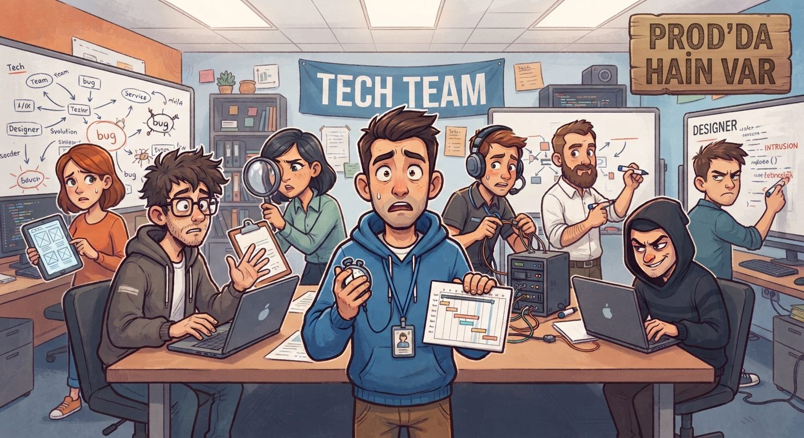

# Who Broke Prod? · Prod'da Hain Var

Yazılım dünyası karakterleriyle oynanan, Feign tarzı bir sosyal çıkarım oyunu. Ekip prod'u ayakta tutmaya çalışır, sabotajcılar gizlice çökertmeye çalışır.



## Durum

- **Çok oyunculu oyun (sessiz sürüm):** oda kurma, davet linki, lobi ayarları (otomatik/özel rol dağıtımı, hain ayarı), bütün roller, gece hamleleri, sabah raporu, toplantıda yazılı sohbet ve oylama, PO vetosu, oyun sonu. Az kişiyle denemek için lobide bot eklenebilir.
- **Sırada:** toplantıda sesli sohbet (WebRTC, Space basılı tutarak).
- `demo/` botlara karşı tek kişilik eski demo. Sunucuda `/demo/` adresinden açılır.
- Roller ve özellikleri: `/roller.html`

## Çalıştırma

```bash
npm install
npm start          # http://localhost:3000
npm test           # botlarla hızlandırılmış 300 oyun oynatır
```

Roller ve oyun durumu yalnızca sunucuda tutulur, her oyuncuya sadece kendi görmesi gereken bilgi gider. Sayfayı yenileyen ya da bağlantısı kopan oyuncu aynı tarayıcıdan oyuna geri döner.

## Render'a yayınlama

1. [Render](https://render.com) hesabıyla giriş yap, **New → Blueprint** seç ve bu repoyu bağla. `render.yaml` servisi kendisi tanımlar (ücretsiz plan, Node).
2. İlk kurulum birkaç dakika sürer. Bitince `https://<servis-adı>.onrender.com` adresi oyunun linkidir.
3. Ücretsiz planda servis 15 dakika boş kalınca uyur, ilk giren kişi 30-50 saniye bekler.

## Oyun akışı

1. **Gece:** herkes ofisinde. Roller gizlice hamle yapar, sabotajcılar `#sabotaj` kanalında yazışır.
2. **Sabah:** gece düşen oyuncu ve gerçek rolü açıklanır. Hayatta kalanlar toplantı masasına geçer.
3. **Standup ve oylama:** sesli tartışma (Space basılı tutarak, sadece hayattaysan). Toplantı sırasında istediğin an bir kişiye ya da Atla'ya oy verirsin. Oylar gizlidir, sonuç toplu açıklanır.
4. Biri atılırsa rolü açıklanır ve yeni gece başlar.

**Kazanma:** Ekip tüm sabotajcıları atınca kazanır. Sabotaj, sayıca Ekip'e eşit olunca kazanır.

## Demodaki roller

| Rol | Takım | Yetenek |
| --- | --- | --- |
| Senior Dev | Ekip | Gece bir oyuncunun takımını öğrenir (2 hak). |
| QA Tester | Ekip | Gece bir oyuncuyu hacklere karşı korur, kendini koruyamaz (2 hak). |
| DevOps | Ekip | Bir ofisi izler, oraya kimlerin gittiğini görür (1 hak). |
| Scrum Master | Ekip | Bir oyuncuyu toplantıya çeker, o gece hamlesi boşa gider (1 hak). |
| Tech Lead | Ekip | Bir oyuncuyu escalate eder, ertesi gün oylamaya 2 oyla başlar. Kimin yaptığı gizli (1 hak). |
| İş Analisti | Ekip | Son oylamada kimin kime oy verdiğini görür (1 hak, 11+ kişide 2). |
| Hacker | Sabotaj | Her gece bir oyuncuyu hackler (sınırsız). |
| Sosyal Mühendis | Sabotaj | Bir oyuncuyu Senior Dev'e sabotajcı gösterir. Hacker düşerse hackleme ona geçer (2 hak). |

Tam oyunda ayrıca UI/UX Designer, Junior, Stajyer, Product Owner, Software Architect, Konfigürasyoncu, PM, Freelancer ve Logic Bomb rolleri de olacak.
